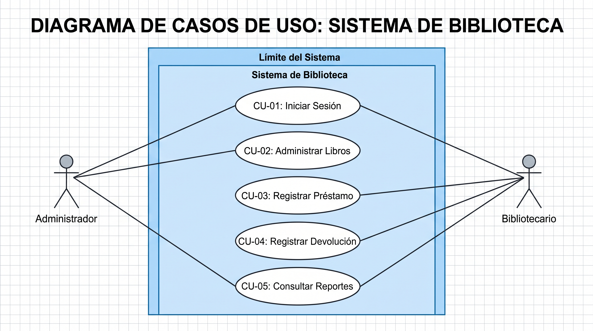
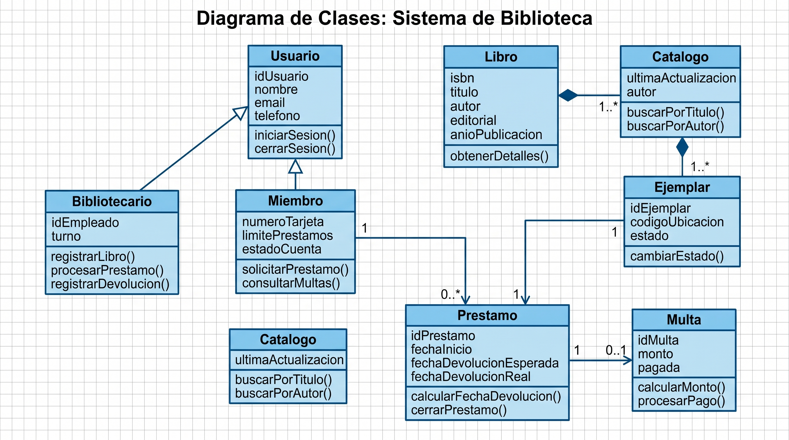
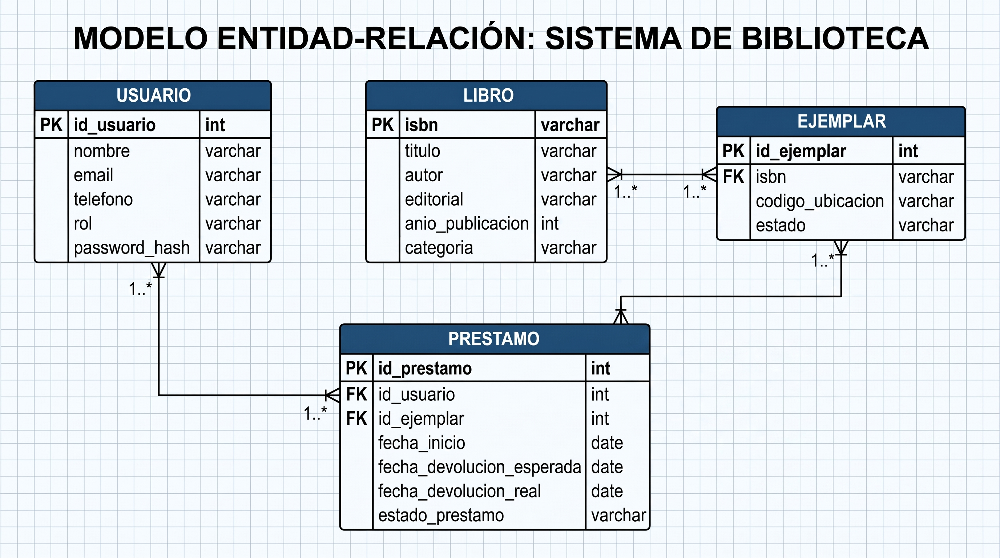
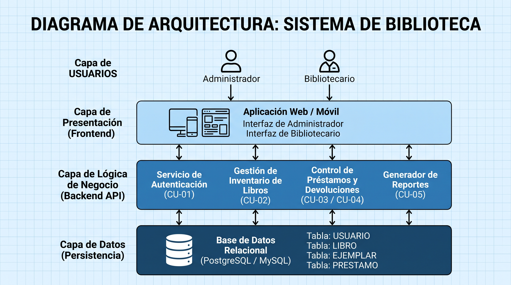
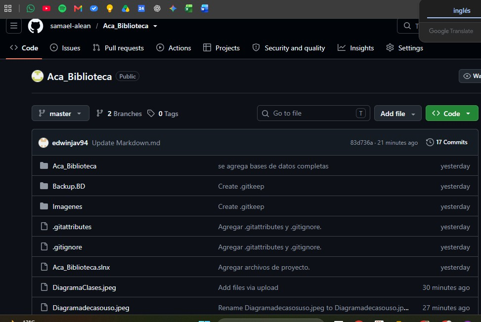

# ACA -- Programación Avanzada

# Sistema de Gestión de Biblioteca

------------------------------------------------------------------------

## PORTADA

CORPORACION UNIFICADA UNIFICADA DE EDUCACION SUPERIOR

**PROGRAMACION AVANZADA**

### ACA -- Programación Avanzada

### Sistema de Gestión de Biblioteca

**Presentado por:**\
Amaury Antonio Echavarria Alean\
Edwin Javier Ayala Forero

**Docente:**\
VERONICA CASTRO

**Fecha:**\
Bogota D.C, 10 Noviembre 2026

------------------------------------------------------------------------

# CONTRAPORTADA

**Sistema de Gestión de Biblioteca**

Proyecto desarrollado como evidencia del curso de **Programación
Avanzada**, aplicando Programación Orientada a Objetos, base de datos
relacional, arquitectura por capas, operaciones CRUD, validaciones,
manejo de excepciones y conexión con SQL Server.

------------------------------------------------------------------------

# TABLA DE CONTENIDO

> **Nota:** Actualizar esta sección al finalizar el documento, de
> acuerdo con la numeración real de las páginas.

1.  Introducción
2.  Objetivos
    -   2.1 Objetivo general
    -   2.2 Objetivos específicos
3.  Planteamiento del problema
4.  Análisis de requerimientos
5.  Casos de uso
6.  Diagrama de clases
7.  Modelo entidad-relación
8.  Diccionario de datos
9.  Arquitectura del sistema
10. Explicación de los módulos desarrollados
11. Capturas de pantalla del sistema
12. Pruebas de funcionamiento
13. Conclusiones
14. Recomendaciones
15. Referencias bibliográficas

------------------------------------------------------------------------

# 1. INTRODUCCIÓN

En la era digital en la que estamos inmersos, es relevante que las instituciones educativas sean capaces de gestionar adecuadamente la información. Por ello, en las bibliotecas escolares y universitarias se pueden implementar sistemas de información para la gestión de recursos bibliográficos, usuarios (estudiantes y profesores) y transacciones. Se pueden instalar sistemas integrados de información que reemplacen los manuales o los semiautomatizados. De esta forma se consiguen optimizar los tiempos de respuesta, el control de inventarios y reducir los errores humanos.

------------------------------------------------------------------------

# 2. OBJETIVOS

## 2.1 Objetivo general

Crear una aplicación de escritorio que permita el manejo de información de forma intuitiva y segura. Se implementará en C# utilizando Windows Forms y SQL Server. Se busca automatizar y optimizar los procesos de registro y consulta de información; además de permitir el préstamo y retorno de libros; y generar reportes relacionados con la bibliografía de la institución educativa.

## 2.2 Objetivos específicos

-   Diseñar la base de datos relacional en SQL Server siguiendo los principios de normalización (Tercera Forma Normal - 3FN) para eliminar redundancias e inconsistencias.
-   Implementar los módulos de mantenimiento (CRUD) para Autores, Editoriales, Libros y Usuarios.
-   Desarrollar la lógica de negocio para la gestión transaccional de préstamos y devoluciones, calculando la disponibilidad de ejemplares y controlando los estados.
-   Implementar una arquitectura de tipo N-Capas (Presentación, Lógica de Negocio, Acceso a Datos y Datos/Entidades) que favorezca la mantenibilidad y el desacople de componentes.
-   Incluir mecanismos de consulta de datos y reportes operativos que ayuden en la toma de decisiones administrativas.
-   Ejecutar un plan de pruebas funcionales para validar que los módulos se ejecutan correctamente y probar la robustez de las conexiones a la base de datos.

------------------------------------------------------------------------

# 3. PLANTEAMIENTO DEL PROBLEMA

## 3.1 Descripción del problema

Los problemas de las instituciones educativas que manejan su biblioteca de manera manual (o en hojas de cálculo aisladas) son complejos. Los más comunes son:

-   Pérdida de control de inventario: Imposibilidad de conocer el stock disponible (o entregado) de un determinado título en tiempo real.   
-   Inconsistencia en devolución: Proceso manual propenso a errores en las fechas de entrega, dificultando el control de usuarios morosos.
-   Duplicidad de información: Ausencia de restricciones relacionales que genera duplicación de datos (autores, editoriales, usuarios).
-   Tiempos de búsqueda elevados: Tiempos de respuesta altos al consultar catálogos o historiales de préstamos.
-   Falta de reportes: Dificultad para generar reportes estadísticos operativos (libros más solicitados, estado general del catálogo).   

Solución Propuesta:
Estos inconvenientes se solucionan centralizando la información en SQL Server mediante transacciones ACID (Atomicidad, Consistencia, Aislamiento y Durabilidad). El sistema cuenta con una interfaz intuitiva desarrollada en C# (Windows Forms).

## 3.2 Alcance

El sistema permitirá:

-   Gestionar libros.
-   Gestionar autores.
-   Gestionar categorías.
-   Gestionar usuarios.
-   Registrar préstamos.
-   Registrar devoluciones.
-   Consultar disponibilidad.
-   Consultar historial de préstamos.

### Fuera del alcance

El sistema no permite:

-   categorizar el soporte para material audiovisual (CD/DVD), artículos científicos o tesis digitales.

------------------------------------------------------------------------

# 4. ANÁLISIS DE REQUERIMIENTOS

## 4.1 Descripción general

El Sistema de Gestión de Biblioteca permitirá administrar la información
relacionada con \[entidades principales\] y controlar los procesos de
\[préstamos, devoluciones, consultas, etc.\].

## 4.2 Actores del sistema

  -----------------------------------------------------------------------
  Actor
  ----------------------------------- -----------------------------------
Autor   
Editoriales   
Libro   
Usuario    
Prestamo    
Reportes    
                                   

  -----------------------------------------------------------------------

## 4.3 Requerimientos funcionales
RF-01	Gestión de Autores	Permite registrar, consultar, modificar y desactivar/eliminar información de los autores de libros.   
RF-02	Gestión de Editoriales	Permite administrar la información de las casas editoriales (nombre, contacto, correo).   
RF-03	Gestión de Libros	Permite registrar títulos bibliográficos vinculando autor, editorial, ISBN, año y stock (total y disponible).   
RF-04	Gestión de Usuarios	Registra datos personales de estudiantes y docentes (documento, nombres, apellidos, teléfono, correo, tipo).   
RF-05	Registro de Préstamos	Permite procesar el préstamo de uno o varios libros a un usuario activo, validando la disponibilidad de stock.   
RF-06	Registro de Devoluciones	Procesa el retorno de los libros prestados, actualizando de forma automática el stock disponible y el estado del préstamo.   
RF-07	Consultas de Catálogo	Ofrece filtros de búsqueda multicriterio por título, ISBN, autor o categoría.   
RF-08	Generación de Reportes	Genera reportes de libros prestados, usuarios morosos y catálogo general en pantalla y exportables.   
RF-09	Autenticación y Accesos	Controla el acceso mediante un módulo de inicio de sesión con credenciales de usuario y roles.   

## 4.4 Requerimientos no funcionales

  -----------------------------------------------------------------------
  Código                  Requerimiento           Descripción
  ----------------------- ----------------------- -----------------------
RNF-01	Usabilidad	La interfaz gráfica en Windows Forms debe ser clara, intuitiva y navegable con atajos de teclado.   

RNF-02	Rendimiento	Las consultas a la base de datos deben responder en un tiempo inferior a 2 segundos para cargas estándar.   

RNF-03	Integridad de Datos	Se deben aplicar restricciones de clave primaria, clave foránea y validación de tipos en SQL Server.   

RNF-04	Arquitectura	El código debe estructurarse en 3 o más capas independientes (Presentación, Negocio, Datos).   

RNF-05	Seguridad	Las contraseñas de los usuarios deben guardarse mediante algoritmos de hashing en la base de datos.   

RNF-06	Mantenibilidad	El código en C# debe incluir documentación en línea y nombres bajo la convención PascalCase y camelCase.   

------------------------------------------------------------------------

# 5. CASOS DE USO

## 5.1 Diagrama de casos de uso

## 5.2 Descripción de casos de uso

CU-01	Iniciar Sesión	Bibliotecario / Administrador	Valida las credenciales para acceder al sistema.

CU-02	Administrar Libros	Administrador	Gestiona el inventario de textos bibliográficos.

CU-03	Registrar Préstamo	Bibliotecario	Registra la salida de libros asignándolos a un usuario.

CU-04	Registrar Devolución	Bibliotecario	Procesa el reingreso del material bibliográfico al stock.

CU-05	Consultar Reportes	Administrador / Bibliotecario	Visualiza listados e informes de la operación.

------------------------------------------------------------------------

# 6. DIAGRAMA DE CLASES

## 6.1 Diagrama de clases

## 6.3 Principales clases

  Clase             Responsabilidad
  ----------------- --------------------------------------------------------
  Libro             Representar y gestionar la información de los libros.
  Autor             Representar y gestionar los autores.
  Categoria         Representar las categorías de los libros.
  Usuario           Representar los usuarios de la biblioteca.
  Prestamo          Gestionar la información de los préstamos.
  DetallePrestamo   Relacionar los libros incluidos en un préstamo.
  Devolucion        Gestionar las devoluciones y calcular retrasos/multas.

------------------------------------------------------------------------

# 7. MODELO ENTIDAD-RELACIÓN

## 7.1 Descripción

Representa la estructura de la base de datos y permite organizar la informacion necesaria para el funcionamiento de la aplicacion.

## 7.2 Diagrama entidad-relación

Insertar aquí el modelo entidad-relación.

)

## 7.3 Relaciones principales

El recorrido del modelo inicia en la entidad USUARIO, quien posee las credenciales y el rol para interactuar con el sistema; al solicitar o gestionar una transacción, este usuario se vincula directamente a un registro en PRESTAMO, el cual controla el ciclo de vida del trámite mediante sus fechas de inicio, devolución esperada y devolución real. A su vez, cada préstamo se asigna a un EJEMPLAR físico específico identificado por su código de ubicación y estado de disponibilidad en estantería, el cual finalmente remite a la entidad LIBRO, donde se centraliza la ficha bibliográfica general con su ISBN, título, autor, editorial y categoría.

------------------------------------------------------------------------

# 8. DICCIONARIO DE DATOS

## 8.1 Convenciones

  Abreviatura   Significado
  ------------- -----------------------------
  PK            Clave primaria
  FK            Clave foránea
  UQ            Campo con valor único
  NULL          Campo que puede estar vacío
  NOT NULL      Campo obligatorio

## 8.2 Tabla: Autor

  Campo             Tipo de dato   Clave   Nulo   Descripción
  ----------------- -------------- ------- ------ --------------------------------
  idAutor           INT            PK      No     Identificador único del autor.
  nombre            VARCHAR(100)   \-      No     Nombre del autor.
  apellidos         VARCHAR(100)   \-      No     Apellidos del autor.
  nacionalidad      VARCHAR(50)    \-      Sí     Nacionalidad del autor.
  fechaNacimiento   DATE           \-      Sí     Fecha de nacimiento.

## 8.3 Tabla: Categoria

  Campo         Tipo de dato   Clave   Nulo   Descripción
  ------------- -------------- ------- ------ --------------------------------------
  idCategoria   INT            PK      No     Identificador único de la categoría.
  nombre        VARCHAR(50)    UQ      No     Nombre de la categoría.
  descripcion   VARCHAR(200)   \-      Sí     Descripción de la categoría.

## 8.4 Tabla: Libro

  Campo             Tipo de dato   Clave   Nulo   Descripción
  ----------------- -------------- ------- ------ -----------------------------------
  idLibro           INT            PK      No     Identificador único del libro.
  codigo            VARCHAR(20)    UQ      No     Código único del libro.
  titulo            VARCHAR(200)   \-      No     Título del libro.
  anioPublicacion   INT            \-      Sí     Año de publicación.
  idAutor           INT            FK      No     Autor asociado al libro.
  idCategoria       INT            FK      No     Categoría del libro.
  cantidad          INT            \-      No     Cantidad de ejemplares.
  estado            VARCHAR(20)    \-      No     Estado del libro.
  sinopsis          VARCHAR(500)   \-      Sí     Descripción o sinopsis del libro.

## 8.5 Tabla: Usuario

  Campo             Tipo de dato   Clave   Nulo   Descripción
  ----------------- -------------- ------- ------ ----------------------------------
  idUsuario         INT            PK      No     Identificador único del usuario.
  documento         VARCHAR(20)    UQ      No     Número de documento.
  tipoDocumento     VARCHAR(20)    \-      No     Tipo de documento.
  nombre            VARCHAR(100)   \-      No     Nombre del usuario.
  apellidos         VARCHAR(100)   \-      No     Apellidos del usuario.
  direccion         VARCHAR(150)   \-      Sí     Dirección del usuario.
  telefono          VARCHAR(20)    \-      Sí     Teléfono de contacto.
  correo            VARCHAR(100)   \-      Sí     Correo electrónico.
  fechaNacimiento   DATE           \-      Sí     Fecha de nacimiento.
  estado            VARCHAR(20)    \-      No     Estado del usuario.

## 8.6 Tabla: Prestamo

  Campo           Tipo de dato   Clave   Nulo   Descripción
  --------------- -------------- ------- ------ -----------------------------------
  idPrestamo      INT            PK      No     Identificador único del préstamo.
  idUsuario       INT            FK      No     Usuario que realiza el préstamo.
  fechaPrestamo   DATETIME       \-      No     Fecha del préstamo.
  estado          VARCHAR(20)    \-      No     Estado del préstamo.

## 8.7 Tabla: DetallePrestamo

  ---------------------------------------------------------------------------------------
  Campo                     Tipo de dato    Clave          Nulo           Descripción
  ------------------------- --------------- -------------- -------------- ---------------
  idDetalle                 INT             PK             No             Identificador
                                                                          único del
                                                                          detalle.

  idPrestamo                INT             FK             No             Préstamo al que
                                                                          pertenece.

  idLibro                   INT             FK             No             Libro prestado.

  fechaDevolucionEstimada   DATE            \-             No             Fecha estimada
                                                                          de devolución.

  fechaDevolucionReal       DATE            \-             Sí             Fecha real de
                                                                          devolución.

  valor                     DECIMAL(10,2)   \-             No             Valor asociado
                                                                          al préstamo, si
                                                                          aplica.

  multa                     DECIMAL(10,2)   \-             Sí             Valor de la
                                                                          multa generada.

  estado                    VARCHAR(20)     \-             No             Estado del
                                                                          detalle.
  ---------------------------------------------------------------------------------------

## 8.8 Tabla: Devolucion

  Campo             Tipo de dato    Clave   Nulo   Descripción
  ----------------- --------------- ------- ------ ---------------------------------------
  idDevolucion      INT             PK      No     Identificador único de la devolución.
  idDetalle         INT             FK      No     Detalle del préstamo devuelto.
  fechaDevolucion   DATETIME        \-      No     Fecha de devolución.
  diasRetraso       INT             \-      No     Número de días de retraso.
  multa             DECIMAL(10,2)   \-      Sí     Valor de la multa, si aplica.

------------------------------------------------------------------------

# 9. ARQUITECTURA DEL SISTEMA

## 9.1 Descripción general

El Sistema de Gestión de Biblioteca se desarrolla utilizando una
**arquitectura por capas**, con el propósito de separar las
responsabilidades del sistema y facilitar su mantenimiento, organización
y evolución.

La arquitectura está compuesta por:

1.  Capa de Presentación.
2.  Capa de Lógica de Negocio.
3.  Capa de Acceso a Datos.
4.  Capa de Base de Datos.

## 9.2 Diagrama de arquitectura

Insertar aquí el diagrama de arquitectura.

## 9.3 Capa de Presentación

**Responsabilidad:**

Es la capa mediante la cual el usuario interactúa con el sistema.

**Componentes:**

-   \[FrmPrincipal\]
-   \[FrmLibros\]
-   \[FrmAutores\]
-   \[FrmCategorias\]
-   \[FrmUsuarios\]
-   \[FrmPrestamos\]
-   \[FrmDevoluciones\]

**Tecnología utilizada:**

-   C#
-   Windows Forms
-   \[.NET versión utilizada\]

## 9.4 Capa de Lógica de Negocio

**Responsabilidad:**

Procesa las solicitudes provenientes de la interfaz, aplica las reglas
de negocio y coordina las operaciones.

**Componentes:**

-   \[LibroController\]
-   \[AutorController\]
-   \[CategoriaController\]
-   \[UsuarioController\]
-   \[PrestamoController\]
-   \[DevolucionController\]

## 9.5 Capa de Acceso a Datos

**Responsabilidad:**

Gestiona la comunicación entre la aplicación y SQL Server.

**Componentes:**

-   \[Conexion\]
-   \[LibroDAO\]
-   \[AutorDAO\]
-   \[CategoriaDAO\]
-   \[UsuarioDAO\]
-   \[PrestamoDAO\]
-   \[DevolucionDAO\]

**Tecnologías utilizadas:**

-   SQL Server.
-   ADO.NET / \[tecnología realmente utilizada\].
-   Consultas parametrizadas.

## 9.6 Capa de Base de Datos

La información del sistema se almacena en:

**Base de datos:** `[NombreBaseDatos]`

**Tablas principales:**

-   Autor
-   Categoria
-   Libro
-   Usuario
-   Prestamo
-   DetallePrestamo
-   Devolucion

## 9.7 Flujo de información

[ Usuario ]
   │  ▲
   │  │ (1. Solicitud / 8. Respuesta)
   ▼  │
[ Capa de Presentación (Frontend) ]
   │  ▲
   │  │ (2. Petición HTTP / 7. Datos formateados)
   ▼  │
[ Lógica de Negocio (Backend) ]
   │  ▲
   │  │ (3. Reglas de negocio / 6. Entidades/DTOs)
   ▼  │
[ Capa de Acceso a Datos (ORM/DAL) ]
   │  ▲
   │  │ (4. Consultas SQL / 5. ResultSets)
   ▼  │
[( Base de Datos: SQL Server )]

Las respuestas de la base de datos realizan el recorrido inverso hasta
llegar nuevamente a la interfaz.

------------------------------------------------------------------------

# 10. CAPTURAS DE PANTALLA DEL SISTEMA

Sección evidencias de funcionalidades

## 10.1 Menú principal

## 10.2 Gestión de libros

## 10.3 Gestión de autores

## 10.4 Gestión de categorías

## 10.5 Gestión de usuarios

## 10.6 Registro de préstamos

## 10.7 Registro de devoluciones

## 10.8 Consultas

------------------------------------------------------------------------

# 11. PRUEBAS DE FUNCIONAMIENTO

## 11.1 Estrategia de pruebas

Describir cómo se verificó el funcionamiento del sistema.

## 11.2 Casos de prueba

  ------------------------------------------------------------------------------------------
  ID          Funcionalidad   Entrada / Acción Resultado        Resultado       Estado
                                               esperado         obtenido        
  ----------- --------------- ---------------- ---------------- --------------- ------------
  CP01        Registrar libro Datos válidos    Libro registrado Se registra el libro   Aprobado
                                               correctamente                    

  CP02        Registrar libro Código repetido  Mostrar mensaje  Se repite el ISBN y no se guarda el libro   Aprobado
                                               de validación                    

  CP03        Registrar       Datos válidos    Usuario          Se guarda el usuario correctamente   Aprobado
              usuario                          registrado                       

  CP04        Registrar       Libro disponible Préstamo         Se registra un prestamo   Aprobado
              préstamo                         registrado y                     
                                               disponibilidad                   
                                               actualizada                      

  CP05        Registrar       Libro sin        No permitir el   No hay mas disponibilidad del libro   Aprobado
              préstamo        disponibilidad   préstamo                         

  CP06        Registrar       Préstamo activo  Registrar        Prestamos activos   Aprobado
              devolución                       devolución y                     
                                               actualizar                       
                                               disponibilidad                   
                   
  ------------------------------------------------------------------------------------------

## 11.3 Evidencias de pruebas

Insertar capturas que demuestren los resultados de las pruebas.

### Prueba CP01

**Resultado:** \[Descripción.\]

### Prueba CP02

**Resultado:** \[Descripción.\]

------------------------------------------------------------------------

# 12. CONCLUSIONES

El desarrollo del Sistema de Gestión de Biblioteca en C#, Windows Forms y SQL Server ha permitido dar solución a los cuellos de botella de información de la institución educativa, logrando un control automatizado del catálogo y del ciclo de vida de los préstamos.
El modelado de la base de datos bajo la Tercera Forma Normal (3FN) cumple con los requisitos de integridad referencial, eliminando redundancias en autores, editoriales, préstamos y usuarios.
La implementación de una arquitectura en N-Capas desacopla la lógica de acceso a datos de la interfaz gráfica, facilitando la mantenibilidad y escalabilidad del sistema.
Las pruebas de funcionamiento demuestran que las transacciones complejas (actualizaciones simultáneas de cabeceras de préstamo y stock de ejemplares) se realizan cumpliendo los principios ACID, garantizando la consistencia operativa.

# 13. RECOMENDACIONES

Implementación de lectores de código de barras/RFID: Adaptar la interfaz gráfica en Windows Forms para permitir la captura automatizada mediante código de barras o etiquetas RFID tanto en carnés de usuarios como en el material bibliográfico.
Migración a Servicios Web (Web API): Evolucionar la capa de datos hacia una API RESTful que permita la integración de futuras plataformas web y móviles para los estudiantes.
Planes de Respaldo Automatizados: Configurar tareas programadas mediante SQL Server Agent para ejecutar copias de seguridad (Backups) automáticas y periódicas de la base de datos BibliotecaBD.
Módulo de Notificaciones: Integrar un servicio de mensajería/correo electrónico (SMTP / API externa) para notificar recordatorios de devolución 24 horas antes del vencimiento.

------------------------------------------------------------------------

# 14. REFERENCIAS BIBLIOGRÁFICAS

Ceballos, F. J. (2019). Enciclopedia de Microsoft Visual C# (5.ª ed.). Alfaomega / Ra-Ma.
Date, C. J. (2018). Introducción a los sistemas de bases de datos (8.ª ed.). Pearson Educación.
Elmasri, R., & Navathe, S. B. (2017). Fundamentos de sistemas de bases de datos (7.ª ed.). Pearson.
Microsoft Learn. (2024). Documentación oficial de ADO.NET y Windows Forms para C#. Microsoft Docs.
Pressman, R. S. (2020). Ingeniería del software: Un enfoque práctico (9.ª ed.). McGraw-Hill Education.
Sommerville, I. (2019). Ingeniería de Software (10.ª ed.). Pearson Educación.

------------------------------------------------------------------------

# ANEXOS

## Anexo A. Repositorio GitHub

(https://github.com/samael-alean/Aca_Biblioteca)

## Anexo B. Script de base de datos

**Archivo:** `[Nombre del archivo .sql]`

## Anexo C. Evidencia de Git y GitHub

